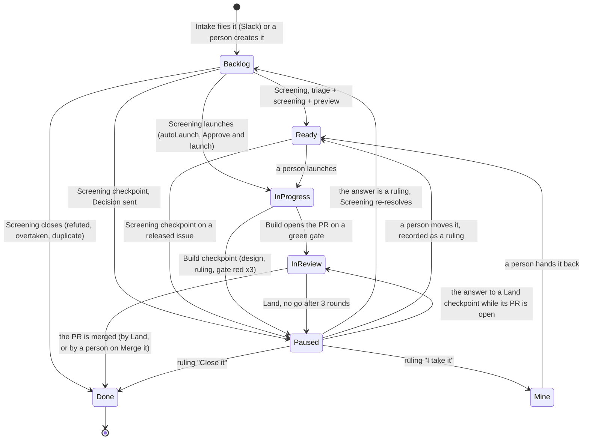

# Workflow

The map every factory run follows. A person who customises the workflow edits this file; the
routines follow the edited map.

## Statuses and who moves them

Statuses: `backlog`, `paused`, `mine`, `ready`, `in_progress`, `in_review`, `done`. Each pipe is
ordered by `priority`, empty last, then oldest first (`SKILL.md` § One issue per run).

| Stage | Routine | Cadence (UTC) | Pipe | Exits | Decision `need` |
|---|---|---|---|---|---|
| Intake | Intake | a person's message in the configured Slack channel | the message that woke it | one Backlog issue per independent request, each citing the message; or a pointer to an existing issue, a question in the thread, a decline | none: the reporter is asked in the thread |
| Screening | Screening | `*/15 * * * *`; the Monday 06:00 run also sweeps the backlog for duplicates and families | issues with a `ruling` or a person's move to Ready newer than their last `screening` row; then Backlog issues never screened; then the oldest screening due for a refresh | Ready with an agent brief; In progress (§ Launch); Paused, from Backlog, or from Ready on a released issue whose evidence contradicts it; Done with `closeReason` `refuted`, `overtaken` or `duplicate` | `decision`: a ruling the route depends on, or a feature too large for the factory |
| Preview | Screening, in the same run | as Screening | the features its screening routes to preview | Paused: every feature stops on a Decision approving its scope | `decision`, with a mockup when the screen is the question |
| Build | Build | `*/30 * * * *` | In progress issues, launched, with no live claim and no open PR | In review once a PR is linked on a green gate; Paused | `design` for a mockup owed before code; `decision` for a blocking ruling, or the gate red 3 times |
| Land | Land | `*/15 * * * *` | In review issues whose PR head is not yet judged and whose CI has finished; then merged PRs whose issue is not Done | Done once every linked PR is merged; In review after a fix is pushed or Merge it is sent (`waitingOn` set, no Paused); Paused | `decision`: Merge it, on a withheld path, a required human review or `mode` `human`; no go after 3 rounds |

**The answer.** A Paused issue leaves Paused through the run that asked, on its answer
(`deciding-issues`): Backlog for a ruling, Mine for "I take it", Done for "Close it", In review for
the answer to a Land checkpoint while its PR is open; Merge it leaves it In review. A run never continues its own stage after its question.

**A person's gestures.** Launch (Ready to In progress), release (Paused to Ready, read by Screening
as "proceed as last scoped"), taking an issue (to Mine), handing it back (Mine to Ready), and any
other board move. A routine never makes these moves, except the two launches below.

## Launch

Build takes an In progress issue only when the latest move into In progress was a person's, or was
Screening's with a `screening` row naming the launch case and its grant. Any other move into In
progress is not a launch: leave the status; it is a refusal (`SKILL.md` § Refusals),
`Rule: unlaunched`.

Screening launches in two cases, checked as `screening-issues` says: **small and safe**, under the
project's `autoLaunch` switch; **approved and launched**, on a maintainer's answer "Approve and
launch". A feature never launches on `autoLaunch`.
