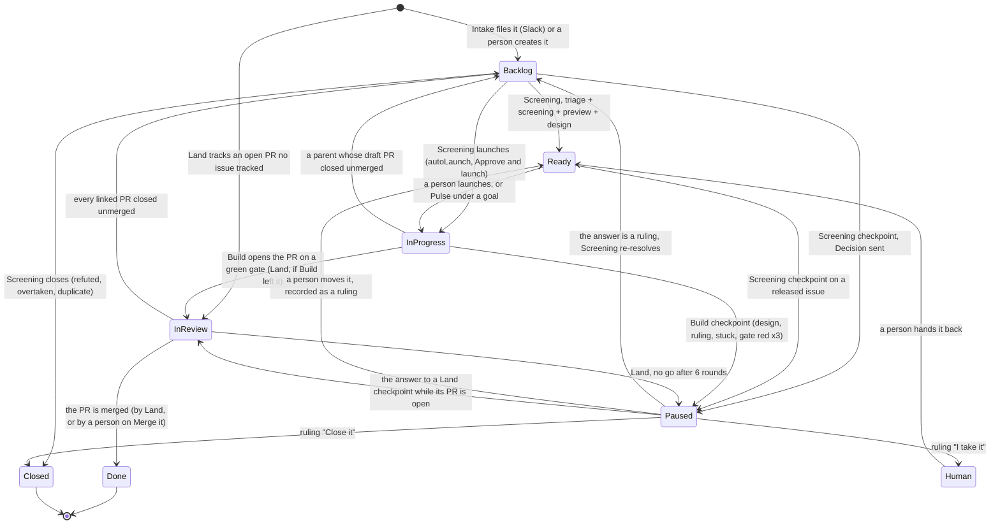

# Workflow

The map every factory run follows. A person who customises the workflow edits this file; the
routines follow the edited map.

## Statuses and who moves them

Statuses: `backlog`, `paused`, `mine`, `ready`, `in_progress`, `in_review`, `done`, `closed`.
`mine` reads Human on the board: a person keeps the issue. Done is delivered work
(`closeReason: done`); Closed is an issue closed without being delivered (`refuted`, `overtaken`,
`duplicate`, `wont_do`). Finished means Done or Closed. An issue closed before Closed existed may
still be Done with one of those four reasons: read it as Closed. Each pipe is
ordered by `priority`, empty last, then oldest first (`SKILL.md` § One wake, one piece of work).

| Stage | Routine | Cadence (UTC) | Pipe | Exits | Decision `need` |
|---|---|---|---|---|---|
| Intake | Intake | a person's message in the configured Slack channel | the message that woke it | one Backlog issue per independent request, each citing the message; or a pointer to an existing issue, a question in the thread, a decline | none: the reporter is asked in the thread |
| Screening | Screening | an issue created in Backlog, or an issue whose status becomes Backlog (a ruling's answer sends it there); `0 7-17/3 * * 1-5` as the net | the issue of its wake; in a burst of issues created together, and for the net, issues with a `ruling` newer than their last `screening` row, then Backlog issues never screened, then those due a refresh (`screening-issues` § Which issue) | Ready with an agent brief and a `priority`; In progress (§ Launch); Paused, from Backlog, or from Ready on a released issue whose evidence contradicts it; Done with `closeReason` `refuted`, `overtaken` or `duplicate` | `decision`: a ruling the route depends on |
| Preview | Screening, in the same run | as Screening | the features its screening routes to preview | Paused: every feature stops on a Decision approving its scope | `decision`, with a mockup when the screen is the question |
| Design | Screening, in the same run | as Screening | the `full` issues its screening routes to design, and those a ruling resumes there | Paused: one card of the design conversation, then the Decision approving the design | `decision`, with a mockup when the screen is the question |
| Build | Build | an issue whose status becomes In progress; a push to a draft PR whose body carries `<!-- factory:build -->`; `0 */4 * * *` as the net | the issue of its wake, launched (§ Launch) and with no open PR, or a parent (§ A large issue and its tasks) with Build's own draft; one whose open PR a dead run left, only to finish the move to In review. The net takes the head of the In progress issues with no open PR or with Build's draft | In review once a PR is linked on a green gate; In progress under a `progress` row; Paused | `design` for a mockup owed before code; `decision` for a blocking ruling, stuck work, or the gate red 3 times |
| Land | Land | a pull request opened, marked ready, merged or closed, or a workflow a pull request started completing; `0 7-17 * * 1-5` as the net | the PR of its wake, tracked first (an issue created In review for one no issue tracks, an issue left behind moved to In review). The net takes, in order (`landing-pull-requests` § 3): a head to judge, every check on it concluded; a ruling to apply, answering a Land checkpoint with anything but Merge it; a go to retry, neither merged, enqueued nor awaiting Merge it; after settling every issue whose linked PRs all merged or closed | Done once every linked PR is merged; Backlog when every linked PR closed unmerged; In review after a fix is pushed or Merge it is sent (`waitingOn` set, no Paused); Paused | `decision`: Merge it, on a withheld path, a required human review or `mode` `human`; no go after 6 rounds |
| Pulse | Pulse | `*/15 * * * *`; a goal created | the routines' runs, the active goals, the Ready issues | an alert or its all-clear to a person; a Ready issue launched under a goal (§ Launch); one proposal card a day; never another status | none: its proposal is a card, and an unanswered one launches nothing |
| Ops | Ops | `0 7-17 * * 1-5`, its only wake | the whole factory: every run of the other stages, every issue that is not finished, every open PR | a relaunch of the stage that owns stranded work, a report, once a day an evaluation; never a status a stage owns | none: what waits on a person goes in its report |

**Working hours.** The clocks of Screening, Land and Ops run on weekdays, from 07:00 to 17:00 UTC
(08:00 to 18:00 in Paris in winter, 09:00 to 19:00 in summer): Ops and Land's net every hour,
Screening's net every three hours. A trigger has no hours: an event still wakes its stage at night
and at the weekend, and no net or tick follows it before the next working hour.

**The answer.** A Paused issue leaves Paused through the run that asked, on its answer
(`deciding-issues`): Backlog for a ruling, Human for "I take it", Closed for "Close it", In review for
the answer to a Land checkpoint while its PR is open; Merge it leaves it In review. A run never continues its own stage after its question.

**A person's gestures.** Launch (Ready to In progress), setting a goal, release (any move to Ready by a person,
read by Screening as "proceed as last scoped"), taking an issue (to Human), handing it back (Human to Ready), and any
other board move. A routine never makes these moves, except the launches below.

## A large issue and its tasks

A `full` issue whose design is approved is a **parent**: it holds the idea, the design, and the one
pull request per repository. Its **tasks** are child issues that `designing-issues` writes, each
with `parent` the issue and `origin: design`. A task is one piece of the design, built on the
parent's branch. Everything a person rules, launches, reviews or merges happens once, on the
parent.

| A task is | Means | Moved there by |
|---|---|---|
| Ready | it waits its turn | `designing-issues`, creating it; Build, after an `attempt` on it; Screening, returning it after a ruling; Land, when the parent's pull request closed unmerged |
| In progress | Build is on it | Build |
| In review | built and committed on the parent's branch | Build |
| Paused | it waits on a person: stuck, or red three times | Build |
| Done | the parent's pull request merged | Land |

The parent takes the ordinary statuses: In progress from its launch until every task is In review,
then In review with its pull request marked ready, then Done.

A task a ruling took (Human) or that is Closed stops its parent: Build's next run
pauses the parent on a `decision` checkpoint, `Resume at: build`, with the options Build without
that piece (Approve and launch), I take the whole issue, Close it. A ruling that answers Build
without it leaves that task out: the parent is complete once every other task is In review.

Every pipe, count, limit and report of the factory is made of issues that are not tasks; a task is
reached only through its parent, by the Build run that holds the parent. An umbrella whose tasks
carry another `origin` is an older container: its tasks are the work, each on its own.

## Launch

Build takes an In progress issue only when the latest move into In progress was a person's, was
Screening's with a `screening` row naming the launch case and its grant, or was Pulse's with a
`signal` row (`Rule: goal_launch`) quoting the goal or the answer it acts on. Any other move into In
progress is not a launch: leave the status; it is a refusal (`SKILL.md` § Refusals),
`Rule: unlaunched`. A task is launched by its parent's launch (§ A large issue and its tasks). An
issue Ops moved under a standing order, before goals replaced it, keeps that launch.

Screening launches in two cases, checked as `screening-issues` says: **small and safe**, under the
project's `autoLaunch` switch; **approved and launched**, on a maintainer's answer "Approve and
launch". A feature never launches on `autoLaunch`.

Pulse moves a Ready issue to In progress only under an active goal (`watching-the-factory`
§ Goals), writing that `signal` row first. Relaunching Build on an issue already In progress,
which Ops does, is no launch: the issue keeps the launch it had.
